<p align="center">
  
</p>

<p align="center">
  <b>Notes as markers you leave behind.</b><br>
  A markdown notebook app for the Mac, made like a pocket memo book.
</p>

**Cairn** is pronounced ***KARN***. It's named for the stacks of stones that mark a trail.

Every page is a plain `.md` file in a folder you choose, so your notes are yours: open them in any editor, back them up anywhere, keep them forever. On top of those files, Cairn gives you a notebook worth picking up. It has kraft covers that animate as they arrive, paper you can choose, a notebook that sits on your desktop and turns its pages, stickers and merit badges, and an iA Writer-style editor at its core. Sync goes through your own private GitHub repo, as signed commits.

**Version 0.17.0** · [What's new](CHANGELOG.md) · [Download](https://github.com/ry-ops/cairn/releases/latest) · MIT

## Install

Cairn is a Mac app, built for Apple silicon and Intel Macs.

1. **Download** the disk image from the [latest release](https://github.com/ry-ops/cairn/releases/latest): `Cairn_…_aarch64.dmg` for Apple silicon (M1 and later), or `Cairn_…_x64.dmg` for Intel.
2. **Open the disk image** and drag **Cairn** into **Applications**.
3. **Allow Cairn in Privacy & Security.** Open Cairn once. macOS will block it, because Cairn isn't signed by an Apple developer account yet. Then go to **System Settings → Privacy & Security**, scroll down to the message about Cairn, and click **Open Anyway**. Confirm, and Cairn opens. You only do this once.
4. **Choose a folder for your vault.** An empty folder starts you off with a *First Cairn* notebook and a welcome note.

> [!IMPORTANT]
> **macOS will block Cairn the first time you open it.** That's expected for an app that isn't notarized by Apple yet. Allow it in **System Settings → Privacy & Security → Open Anyway**. If macOS instead says *"Cairn is damaged and can't be opened"* (versions before 0.14.2 could do that), run this once in Terminal, then open Cairn again:
> ```sh
> xattr -dr com.apple.quarantine /Applications/Cairn.app
> ```

Prefer to build it yourself? See [Develop](#develop).

---

## The editor


Three columns, like a writing app should have: your shelf of notebooks, the notes in the open one, and the page.

- **An iA Writer-style editor** (CodeMirror 6). Markdown stays visible but quiet, in a typewriter face.
- **Focus mode** (⌘D) dims everything but the sentence or paragraph you're on. **Typewriter mode** (⇧⌘T) keeps your line in the middle of the page.
- **Autosave**, word count and reading time in the status bar. ⌘\ hides the sidebars when you want just the page.

## Paper and type


- **Graph, ruled, dot grid or blank.** Each notebook has its own paper (the *Paper* chip under its title), and any page can change it with `paper:` in its frontmatter.
- **Ruling ink** to match a cover: `ruling: "#c98a3a"` in `notebook.yml`.
- **Two faces:** the typewriter face, or **Rock Salt**, a paint-marker hand. The inside front cover is always written in Rock Salt.

## Your shelf


- **Drag to reorder.** The others make room as you drag, and the shelf scrolls when you reach its edge. The order is saved in `shelf.yml`.
- **The ⋯ menu** (or right-click a cover) changes the cover, links the notebook to a repo of its own, or moves it to the vault's `.trash/` folder, where you can restore it.
- **All Notebooks** (⌘0): every cover in a grid, sorted by shelf order, number, A–Z or most recent, with a filter as you type.

## Covers worth looking at


Pocket notebooks are half about the covers, so Cairn takes them seriously.

- **Kraft covers** in seven edition colors, with an edition number and a title plate, two staples on the spine, and a cairn that stacks itself stone by stone. Its top stone nearly topples, rocks back and settles.
- **Four printed styles**, each in several colorways:
  - *Hunter's Field*: a gel-plate monoprint.
  - *North Shore*: watercolor washes.
  - *Ridge Sketch*: pen and ink.
  - *Pine Press*: spot-color letterpress.
- **Each cover moves once.** It plays its motion as it arrives (washes laid down, the pen drawing, ink landing in register, a sun rising), then holds still. Nothing moves while you write.
- **Your own covers:** any SVG, saved to a library that every notebook can use.
- **Original art from Claude:** the `cairn-cover` skill for [Claude Code](https://claude.com/claude-code) reads a notebook's notes for motifs, then draws and installs an original cover in one of the four styles.

## Notebook mode


**⇧⌘F puts the notebook on your desktop**: a borderless notebook, cover first, then the open spread.

- **The inside cover is written by hand:** the edition number, the title, the date it was started, and a table of contents.
- **Turn pages** with a two-finger swipe or ⌥⌘← / ⌥⌘→. Esc puts it away.

## Links and search


- **`[[Wikilinks]]`** by title, with autocomplete as you type `[[`.
  - The `[[Notebook/Title]]`, `[[Title|alias]]` and `[[Title#Heading]]` forms work too.
  - ⌘-click follows a link. A link to a note that doesn't exist yet starts that note.
- **Backlinks:** *Linked from N* lists every note that points here, with the line it's on.
- **⌘K searches every notebook** as you type. It handles prefixes (`switchb` finds *switchbacks*) and phrases, and ranks title matches first. The index is SQLite FTS5, kept in memory, so it never touches your vault.
- **The links stay plain text**: the same `[[…]]` that Obsidian and other tools read.

## Stickers and merit badges


- **A sheet of die-cut stickers** for pages and covers: cairn, compass, pine, peaks, moon, sun, lightning, lake wave, canoe, tent, campfire, camp mug, trail blaze, gold star and *field tested*.
  - Each one lands at a slight tilt, and you peel it off by dragging it away.
  - Add your own SVGs, and Cairn gives them the white die-cut edge.
- **Twelve merit badges**, embroidered patches earned from what's in your vault:
  - the first, tenth and fiftieth note, and five notebooks;
  - ten links, and a link from one notebook into another;
  - a seven-day streak, all four seasons and ten thousand words;
  - five stickers, an original cover, and your first sync.

  A new one stitches itself in at the bottom of the window.

## A vault that sets itself up


- **Pick an empty folder**, and your first notebook is waiting with a note on how everything works.
- **No GitHub repo yet?** Type a name in Sync settings and press *Preview*. Cairn offers to create it as a **private repo** in your account, or in an organization of yours, then shows exactly what the first sync will do.

## Sync that signs its commits


- **GitHub is the sync, through its API.** No git runs on your Mac, so the vault can live anywhere, iCloud Drive included.
- **Every commit is signed by GitHub** and shows as *Verified*.
- **When it syncs:** on launch, a moment after you stop typing, every 5 minutes, and when the window hides.
- **The first sync is always previewed**, and it waits for your OK.
- **Nothing is merged silently.** When a note changed on both sides, yours is kept and theirs is saved beside it as a `.conflict` copy. A note deleted on GitHub goes to the vault's `.trash/` folder, not into thin air.
- **What syncs:** your notes, each notebook's `notebook.yml` and cover art, the shelf order, your merit badges, your own stickers and the cover library. The web companion shows all of it, the same as the app.
- **A notebook can have a repo of its own**, such as a project's `docs/` folder: ⋯ → *Sync with a repo…*. Each note lives in exactly one repo.
- **iCloud Drive:** a vault in iCloud Drive is backed up and on your other Macs. A vault elsewhere can keep a backup copy there.

## Claude can read it


`cairn-mcp` is a local [MCP](https://modelcontextprotocol.io) server that lets Claude search, read and add to your notes. **It only adds; it can't edit or delete anything.**

```sh
cd src-tauri && cargo build --release --bin cairn-mcp
claude mcp add cairn -- "$PWD/target/release/cairn-mcp"
```

| Tool | What it does |
|---|---|
| `cairn_notebooks` / `cairn_notes` | List notebooks; list a notebook's notes |
| `cairn_search` | Full-text search, same rules and ranking as ⌘K |
| `cairn_read` | A note's markdown, by title or file name |
| `cairn_backlinks` | Notes that `[[link]]` to a note, with the linking line |
| `cairn_create_note` | Start a note (dated today, title as heading, optional body) |
| `cairn_append` | Add markdown to the end of a note |

It uses the same vault as the app (from Cairn's settings, `--vault <path>` or `CAIRN_VAULT`). When you come back to Cairn, the note shows what Claude added.

## The companion


`companion/` is **Cairn in a browser**: the app's own interface, built for the web, that you deploy to **your own Cloudflare account**. The same covers, notes, editor, stickers and badges, from any browser, phone included.

- **One click to deploy:** the button below copies it into your GitHub account and deploys it as a Worker on your Cloudflare account, behind Cloudflare Access. Then you copy one value, the Access AUD tag, into your copy's `wrangler.toml`.
- **Locked down:** Cloudflare Access guards it at the edge, and every API call checks the Access token too. Until Access is set up, it serves no notes at all.
- **Edits sync like the app's:** a few seconds after you stop typing they go up as one signed commit, and Cairn on your Mac picks them up on its next sync. Conflicts keep both versions, as the app does.
- **On a phone** it shows one pane at a time: shelf, notes, page.

[](https://deploy.workers.cloudflare.com/?url=https://github.com/ry-ops/cairn/tree/main/companion)

Every step of the form, and how to deploy by hand, are in [companion/README.md](companion/README.md).

---

## Keys

| Key | Action |
|---|---|
| ⌘N / ⇧⌘N | New note / new notebook |
| ⌘D | Focus mode: off → sentence → paragraph |
| ⇧⌘T | Typewriter scrolling |
| ⌘\ | Hide or show the sidebars |
| ⇧⌘F | Notebook mode: the notebook on your desktop |
| ⌥⌘← / ⌥⌘→, two-finger swipe | Turn the page (in notebook mode) |
| ⌘0 | All Notebooks |
| ⌘K | Search every notebook |
| ⌘S | Save now (notes also autosave) |
| ⌘-click / ⌘↩ on a `[[link]]` | Follow it, or start the note it names |
| Esc | Leave notebook mode or All Notebooks |

## Your files

```
Cairn/                         your vault: any folder
  shelf.yml                    the order of the shelf
  badges.yml                   merit badges earned, with dates
  covers/                      your cover library
  stickers/                    your own stickers
  notebooks/
    0001-first-cairn/
      notebook.yml             title, color, paper, ruling, cover, stickers
      cover.svg                an original cover (optional)
      2026-11-16-welcome.md    one note: frontmatter, then markdown
```

- **`notebook.yml` keys:** `cover`, `color` (the title plate), `paper`, `ruling` and `stickers`, plus `repo`, `repo_path` and `repo_branch` for a notebook with its own repo.
  - `cover` can be `kraft-classic`, a preset, `<preset>/<colorway>`, `cover.svg` or `lib:<name>`.
- **Note frontmatter:** `title`, `tags`, `stickers` and `paper`.
- **Derived data stays out of the vault:** the search index and the sync state live in the app's own data folder, so there's nothing extra to sync or back up.

## Develop

Requires Rust (rustup), Node 24 and pnpm 10.

```sh
pnpm install
pnpm tauri dev                     # desktop app, hot reload
pnpm dev                           # browser preview with an in-memory sample vault
pnpm test                          # link tests and Rust tests
pnpm tauri build --bundles app     # src-tauri/target/release/bundle/macos/Cairn.app
python3 docs/readme/build.py       # redraw this README's animations
```

```
src/                    React + CodeMirror 6 frontend
  editor/               focus mode, typewriter mode, markdown theme
  components/           covers, shelf, notebook mode, sheets, stickers, badges
  cover-presets/        the built-in covers and their colorways
  store.ts              Tauri IPC, or an in-memory vault for the browser
src-tauri/src/
  vault.rs              the vault on disk (path-safe, atomic writes, .trash)
  sync.rs               GitHub sync: three-way plan, signed commits
  search.rs             SQLite FTS5 index
  bin/cairn-mcp.rs      the MCP server
companion/              the web companion: a Cloudflare Worker
docs/design/            the design guide: type, covers, colorways
```

If you have iA Writer's open-source fonts installed (iA Writer Duo or Duospace), the editor uses them automatically. See [the design guide](docs/design/cairn-specimen.html) for the type, the cover styles and the colorways.

## Releases

Each version on `main` is a release: the Release workflow tags `v<version>`, publishes the notes from [CHANGELOG.md](CHANGELOG.md), and attaches disk images for Apple silicon and Intel Macs.

## License

[MIT](LICENSE). Rock Salt is licensed under Apache-2.0 and bundled through Fontsource.
